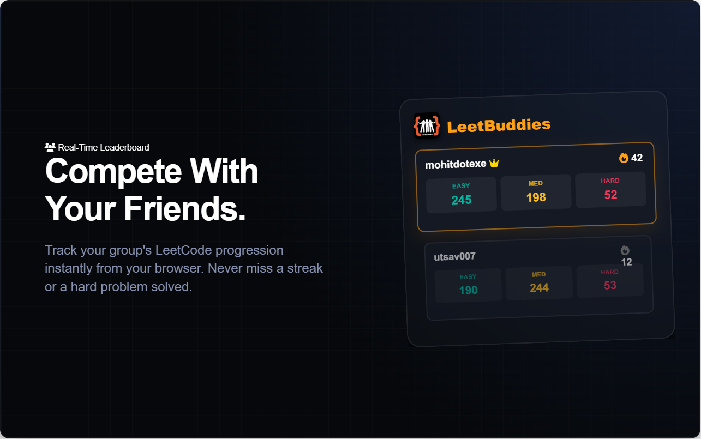
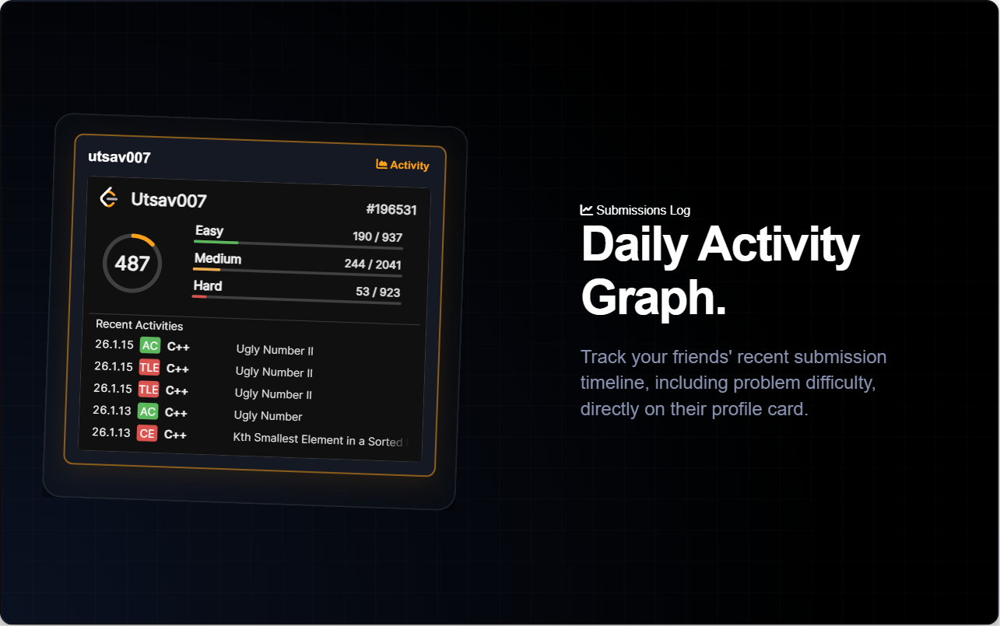
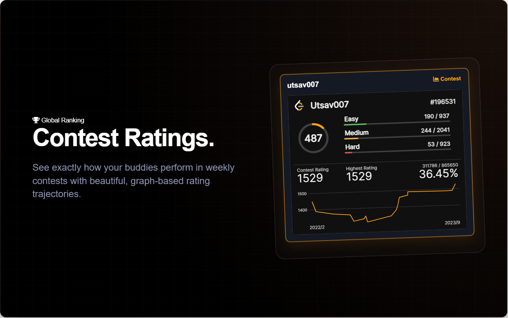
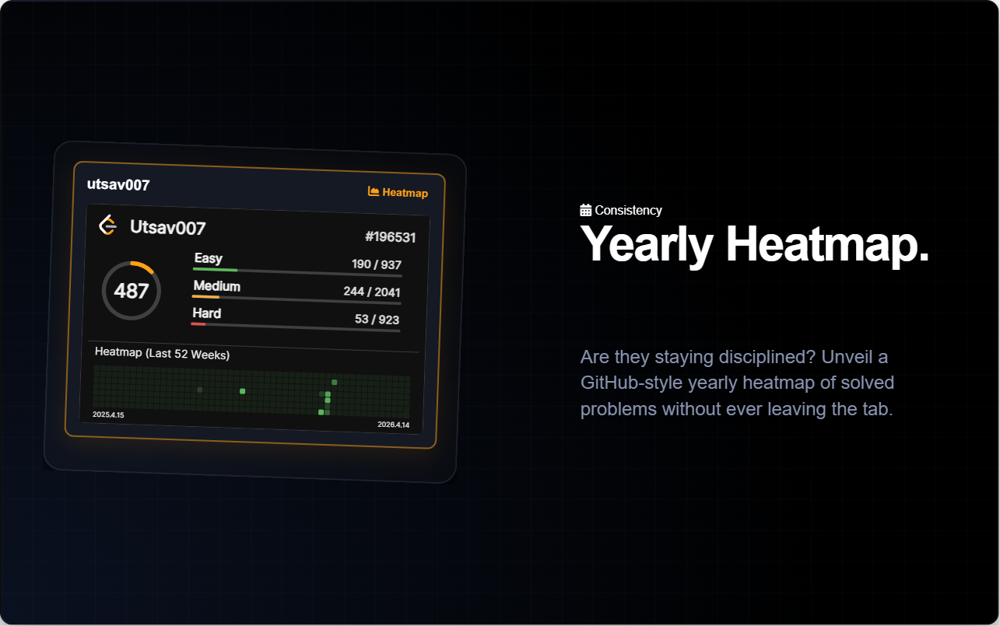
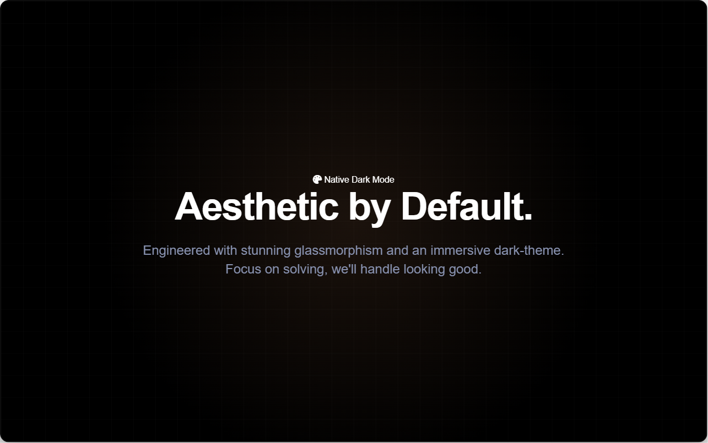

# LeetBuddies

> "Alone, we can do so little; together, we can do so much." - Helen Keller
## Introduction
LeetBuddies is a Chrome extension that helps you keep track of your friends' progress on LeetCode. It provides a leaderboard-style interface to view your friends' problem-solving achievements, including the number of easy, medium, and hard problems they have solved, as well as their total problem count.
## Project Setup/ Installation
1. Clone the repository:
   ```bash
   git clone https://github.com/MohitSinghChauhan/LeetBuddies.git
   ```
2. Install the dependencies:
   ```bash
   cd LeetBuddies
   npm install
   ```
3. Build the TailwindCSS:
   ```bash
   npm run build:tailwind
   ```
4. Load the extension in Chrome:
   - Open Chrome browser
   - Go to `chrome://extensions`
   - Enable "Developer mode"
   - Click on "Load unpacked"
   - Select the `LeetBuddies` directory inside the project


## Tech/Framework used

- JavaScript
- HTML
- Tailwind CSS
- Chrome Extension API
- DB: Local Storage

## Screenshots






## Change Log

### v2.0
- **Kinetic Pro Aesthetic**: Redesigned UI featuring a glassmorphism dark theme and LeetCode accents.
- **Accordion Stats Viewer**: Replaced outdated hover cards with an explicit, high-performance accordion interface for deep metric analysis.
- **Zero-Flash Loading**: Migrated to `chrome.storage.local` with "cached-first" rendering and silent background API refreshes.
- **Scalable SVG Handling**: Native LeetCard API integration with accurate scaling and aspect ratio lockdown.

## Future Goals:
- [ ] Search Users by their Name also.
- [ ] Publish on Chrome Web Store.
- [x] HoverCard Customization: Theme & Extensions.
- [x] Implement Dark Mode.
- [x] UI Improvements.
- [x] Refresh Stats on demand.
- [ ] Store data on remote DB to persist data.


## Credits
- LeetCode Buddies is developed and maintained by [Mohit Singh Chauhan](https://github.com/MohitSinghChauhan).
- Special thanks to the creators of the [LeetCode Stats API](https://leetcode-stats-api.herokuapp.com) and [LeetCode-Stats-Card](https://github.com/JacobLinCool/LeetCode-Stats-Card) for providing the data used in this extension.
- This [StackOverFlow Answer](https://stackoverflow.com/questions/2117046/how-to-show-live-preview-in-a-small-popup-of-linked-page-on-mouse-over-on-link) is life-saver.
- Chrome Developer Docs.
- Our well-known friend ChatGPT.
- For this `Readme` inspiration comes from [A Beginners Guide to writing a Kickass README ✍](https://gist.github.com/akashnimare/7b065c12d9750578de8e705fb4771d2f)

## 🔗 Let's Connect
[](https://www.linkedin.com/in/i-mohit-singh-chauhan/)
[](https://twitter.com/MohitSChauhan)

## License
This project is licensed under the [MIT License](LICENSE).
MIT © [Mohit Singh Chauhan](https://github.com/MohitSinghChauhan)
